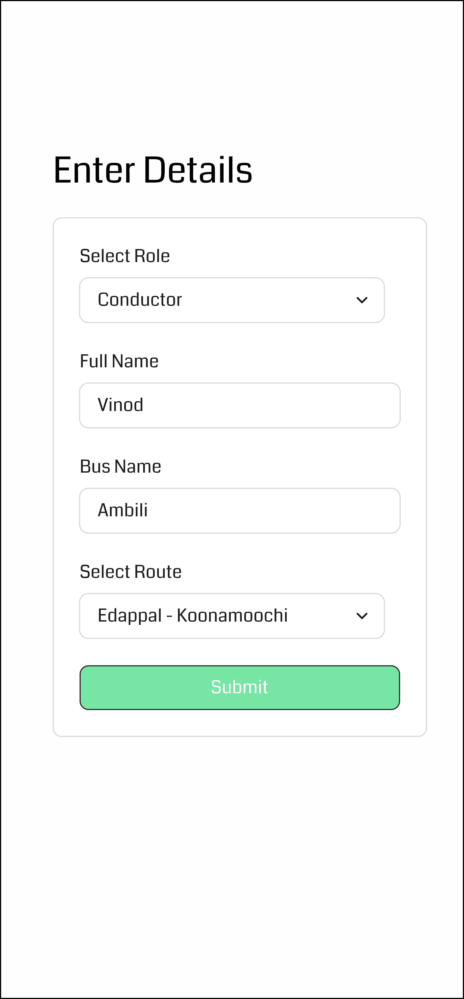
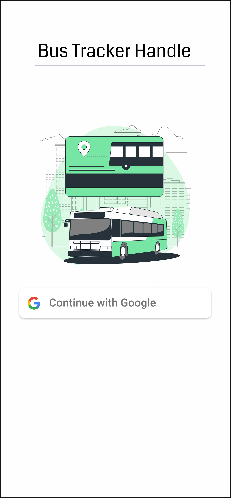
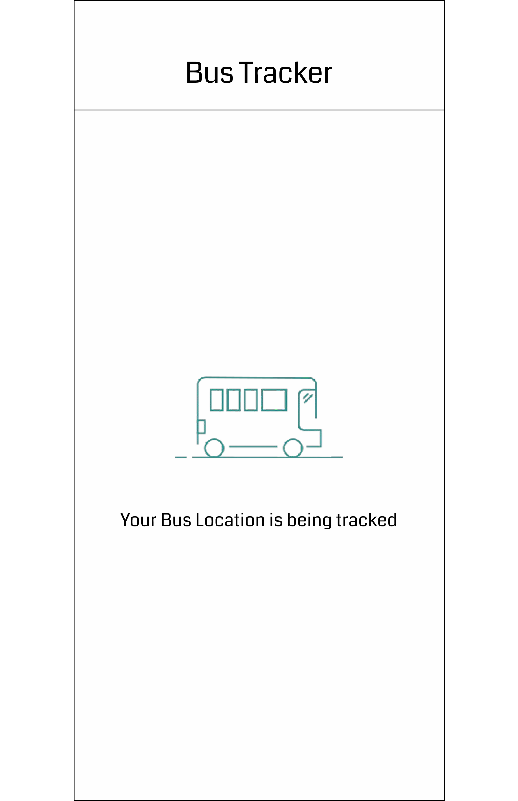

🚌 Bus Tracker

A Flutter mobile app for tracking buses in real time, built for bus conductors and commuters.

Show Image Show Image Show Image

📱 Screenshots
Screen 1	Screen 2	Screen 3
		
Add caption	Add caption	Add caption
✨ Features

📍 Live bus location tracking
🧑‍✈️ Conductor view for managing a trip
🕒 Trip and route information
📲 Clean, simple mobile UI
🛠️ Tech Stack
Technology	Purpose
Flutter	Cross-platform mobile UI
Dart	Programming language
Add more	e.g. Firebase, Google Maps, GetX, Provider
🚀 Getting Started
Prerequisites
Flutter SDK
Android Studio or VS Code with the Flutter extension
An emulator or a physical device
Run locally
bash
# Clone the repository
git clone https://github.com/sherledge/bus_tracker.git
cd bus_tracker

# Install dependencies
flutter pub get

# Run the app
flutter run
Build an APK
bash
flutter build apk --release

📂 Project Structure
lib/        # App source code
assets/     # Images and other static assets
android/    # Android platform code
ios/        # iOS platform code
test/       # Tests

👤 Author

Shabeer
